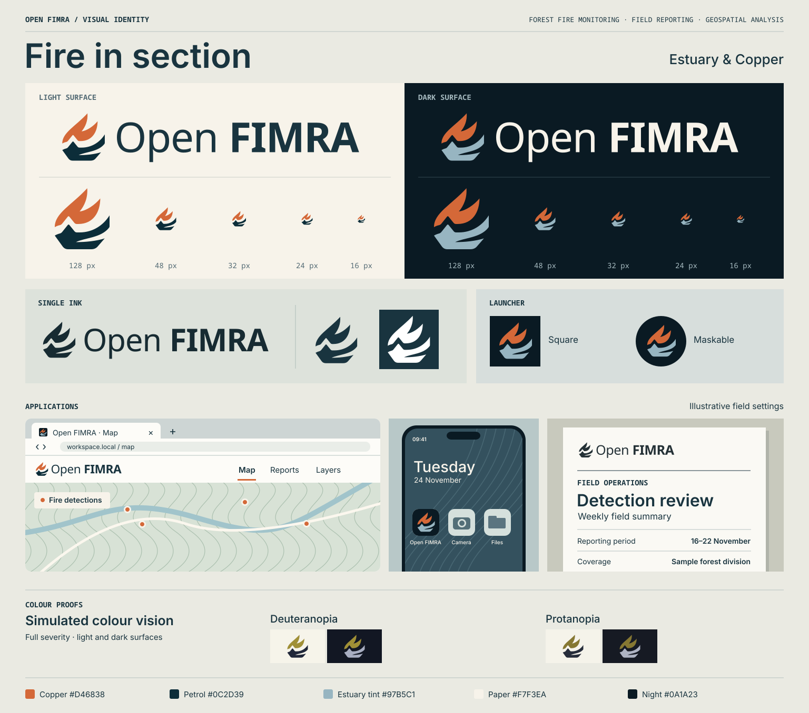

# Open FIMRA logo

The symbol is called **Fire in section**. It shows a wind-bent flame above a cut through the ground. The peak of the terrain fits the notch under the flame, which places a heat observation in the landscape.

## Files

| File | Use |
|---|---|
| `lockup-light.svg` | Symbol and name on light backgrounds. This is the default signature. |
| `lockup-dark.svg` | Symbol and name on dark backgrounds |
| `lockup-mono.svg` | One colour (`currentColor`), for print, stamps and embossing |
| `mark-light.svg` | Symbol alone on light backgrounds, above 24 px |
| `mark-dark.svg` | Symbol alone on dark backgrounds, above 24 px |
| `mark-mono.svg` | Symbol alone in one colour (`currentColor`) |
| `mark-small.svg` | Simplified symbol for 24 px and below. It switches to the dark-background terrain colour when the system is in dark mode. |
| `mark-small-dark.svg` | Simplified symbol fixed for dark backgrounds, for inline use on a dark panel |
| `app-icon.svg`, `app-192.png`, `app-512.png` | Launcher icon on a full-bleed night tile |
| `app-icon-maskable.svg` | Launcher icon with the artwork inside the 80% safe zone, for Android and PWA maskable icons |
| `favicon-16.png`, `favicon-32.png`, `favicon-48.png` | Browser tab icons, each on its own night tile |

All lettering is converted to outlines (Noto Sans Regular and Bold), so the files do not need any fonts installed.

## Colours

| Role | Colour |
|---|---|
| Flame | Copper `#D46838` |
| Terrain on light backgrounds | Petrol `#0C2D39` |
| Terrain on dark backgrounds | Estuary tint `#97B5C1` |
| Lettering on light backgrounds | Ink `#19343F` |
| Light surface and lettering on dark backgrounds | Paper `#F7F3EA` |
| Dark surface and app tile | Night `#0A1A23` |

The copper stays the same on both backgrounds.

**Copper is a logo colour only.** It is close to the fire-age colours on the map, so it is not used for buttons, links or other interface elements. The interface brand colour is a petrol shade (see `tokens.json`).

## Contrast and colour vision

| Pair | Contrast |
|---|---|
| Copper on paper | 3.25:1 |
| Copper on night | 4.93:1 |
| Petrol on paper | 13.08:1 |
| Estuary tint on night | 8.18:1 |
| Ink on paper | 11.82:1 |

All pairs meet the 3:1 minimum for graphics. The two shapes are also separated by an open channel, so the mark does not rely on colour alone. With simulated deuteranopia and protanopia (Machado 2009, full severity), the copper shifts toward ochre, but the flame and the ground stay distinct.

## Rules

- **Clear space.** Keep space around the logo at least equal to the width of the flame notch, about one quarter of the symbol's height.
- **Minimum size.** Use the full symbol above 24 px. At 24 px and below, use `mark-small.svg`. Below 120 px wide, use the symbol alone instead of the lockup.
- **One-colour use.** Use the mono files and set `color` to black or white. Do not recolour the two-colour files.
- **Do not** stretch, rotate, outline or add effects to the logo. Do not separate the flame from the ground, and do not put the colour version on a busy photo or map without a solid backing.
